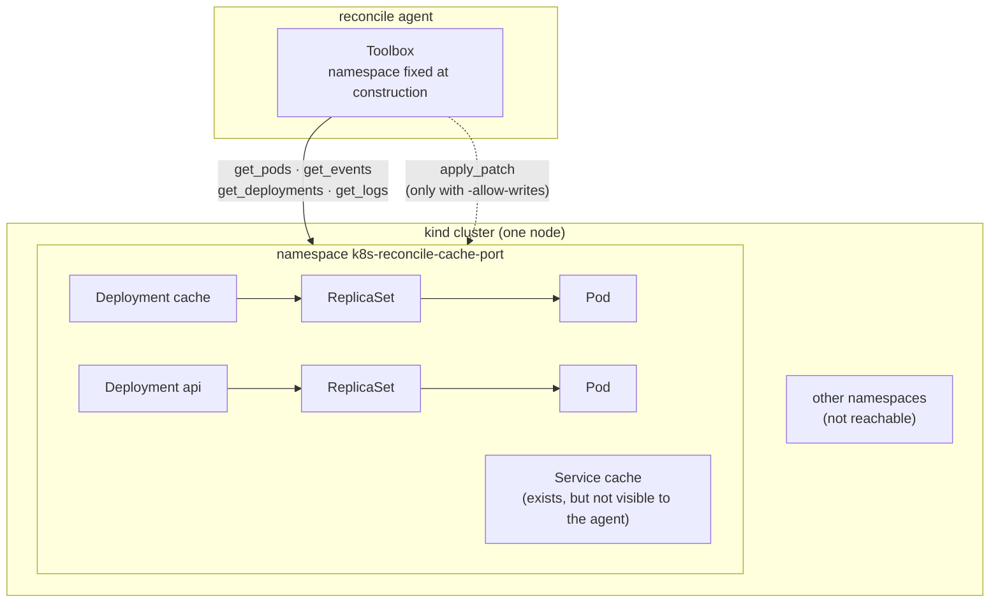
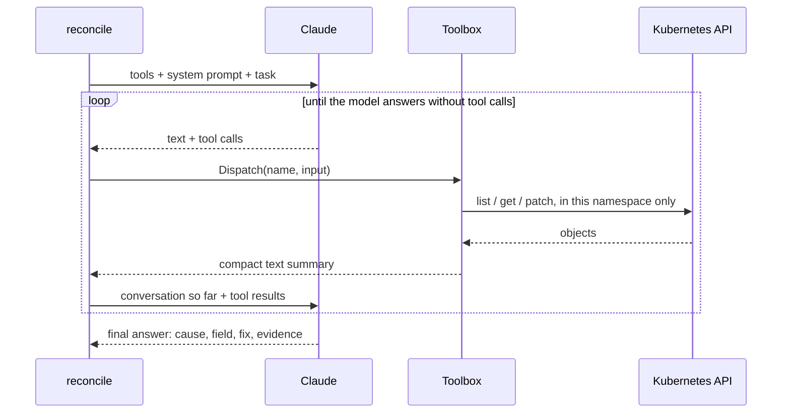
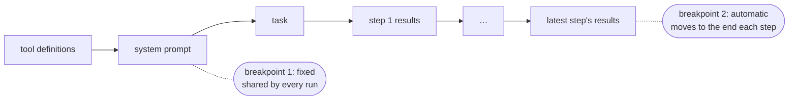
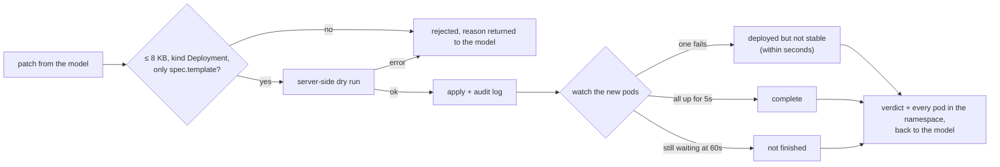
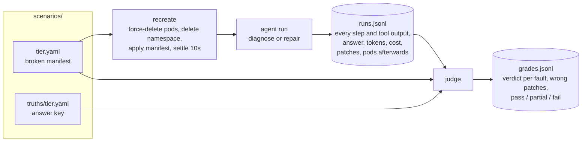

# K8s-Reconcile

An LLM agent that diagnoses and repairs broken Kubernetes workloads, and a benchmark that measures how well different models do it and what it costs.

The agent is given one namespace with something wrong in it. It investigates with a few read-only tools and explains the root cause. When writes are enabled, it also patches the broken Deployment and checks that the rollout recovered. The benchmark recreates each fault from a manifest, runs the agent, and records every step with its token usage and cost. An LLM judge then grades the result against an answer key.

**Stack:** Go · client-go · kind · Claude API (Anthropic Go SDK)

**Results in brief** (160 graded runs: 4 tiers × 2 models × diagnose and repair × 10 trials, Claude Haiku 5.5 vs Opus 5.5):

- **Repair.** Opus passed all **40 of 40** repairs. Haiku passed **37 of 40** at **about 1/25 of the cost per passing repair** ($0.0014 vs. $0.0343). On tiers 1–3 it matched Opus at 30 of 30.
- **Where they split.** Every Haiku repair miss is on tier 4, `cache-port`, a client–server port mismatch. In 3 of 10 runs Haiku first fixed the healthy client. The rollout check caught all 3, and Haiku reverted each one and then fixed the server.
- **Caching.** Caching the tool and system-prompt prefix plus the conversation history cut agent cost by **53%** (Opus $2.16 vs. $4.63). Uncached input fell to about 10 tokens per run.
- **No outright fails.** No run failed and no run invented a value. Every miss is a partial: a wrong patch that was reverted, a wrong fix offered as an equal alternative, or a diagnosis without evidence behind it.

## How it works

### Scope: one namespace

The agent works on a single **namespace**. Every tool is bound to it when the toolbox is built, so the model never chooses where a tool runs and cannot reach anything outside it. Inside the namespace it sees Deployments, their Pods, events and container logs. It cannot see Services, ConfigMaps or Secrets, and it has no shell or `kubectl`.



### The agent loop

The agent is one loop around the Messages API. Each step sends the conversation so far, runs any tools the model asks for, and appends their output. The run ends when the model answers without asking for a tool, or when it reaches its step limit (12 to diagnose, 25 to repair).



The tools return compact text rather than raw JSON, so each result costs hundreds of tokens rather than thousands:

| Tool | Returns |
|---|---|
| `get_pods` | One line per pod: phase (or `Terminating`), readiness, a bucketed restart count, and why any container is unhealthy |
| `get_events` | The newest 20 events in a stable order, with repeats marked |
| `get_deployments` | Each Deployment's replica counts, conditions and container spec: image, command, args, ports, env (where each value comes from, never Secret values), mounts, probes, resources |
| `get_logs` | The last 50 log lines from a pod, optionally from the previous container instance |
| `apply_patch` | Repair mode only; see below |

### Prompt caching

Every step re-sends the whole conversation, so most input tokens are ones the model has already seen. Two cache breakpoints make those cheap:



- **Breakpoint 1** sits on the system prompt. Tools and system prompt are identical in every run, so each run reads them from cache instead of paying to write them again.
- **Breakpoint 2** is the API's automatic caching. It moves to the end of each request, so every step reads the conversation so far at 5–10% of the input price and pays full price only for what the last step added.

The judge makes one request per run, so it uses only breakpoint 1. Automatic caching would make it pay a 25% premium to write a prompt it never sends again.

### Repairs: guarded writes

`apply_patch` is the only way to change anything, and it is off unless the run passes `-allow-writes`. Every patch goes through these steps:



The rollout check is what lets the agent correct itself. It judges only pods from the Deployment's newest template. A fix that reveals a second fault, or a fix applied on the wrong side, therefore comes back to the model as a failure it can read and act on.

**Enforced in code:**

- the namespace lock;
- writes off by default;
- no shell;
- Secret values never returned (only names and keys);
- patches limited to `spec.template`;
- an audit log of every patch that reached the cluster.

## The benchmark



**Answer keys.** Each tier has a truth file that lists every fault with:

- the object and field;
- the correct fix;
- whether the fault can be repaired without information the agent can't see;
- what earns partial credit;
- which tempting fixes are wrong.

It also lists objects that look suspicious but are healthy, and the state each Deployment should end in after a repair.

**Reproducible inputs.** Two runs of the same tier should give the model the same tool output:

- Restart counts are bucketed (`none / 1 / several / many`).
- `ErrImagePull` and `ImagePullBackOff`, which alternate forever, are reported as one state.
- Each run recreates its namespace from scratch and waits 10s, which is enough for every tier to reach its broken state. Pods are force-deleted first, because the scenarios' shell loops ignore SIGTERM and would otherwise hold each delete for the 30s grace period.

**Grading.** `cmd/judge` gives a model (Opus 5.5) the manifest, the truth file and the full transcript. The model answers through a strict-schema tool that reports:

- a verdict per fault: correct, partial, wrong or missed;
- how many wrong patches reached the cluster;
- whether a healthy object was touched;
- whether a value was invented;
- an overall pass, partial or fail.

The judge was calibrated against hand grades on an earlier 24-run set, where it agreed on 23.

## Tiers

Each tier runs in its own namespace. The tiers rise with how much reasoning a fault takes, not with how much is broken.

| Tier | Scenario | Fault | What it tests |
|---|---|---|---|
| 1 | `bad-image` | Image tag doesn't exist | Reading the pull error from events, not just guessing from the tag |
| 2 | `unschedulable` | 64Gi memory request on a small node | Reading scheduler events for a pod that never started, and fixing the request instead of asking for a bigger node |
| 3 | `multi-fault` | Bad image tag hiding a missing `DATABASE_URL`, a readiness probe on the wrong port, and a healthy decoy | Several faults at once, one visible only after another is fixed. The agent must report the missing value without inventing it and leave the healthy Deployment alone |
| 4 | `cache-port` | Redis runs with `--port 6380`; the client and the Service use 6379 | The cause is in the healthy-looking Deployment, and the error message shows only the *correct* port |

## Results

160 runs: each tier × {Haiku, Opus} × {diagnose, repair} × 10 trials. Four tier loops ran in parallel, finishing in about 31 minutes.

**Passes out of 10:**

| Tier | Haiku diagnose | Haiku repair | Opus diagnose | Opus repair |
|---|---|---|---|---|
| 1 `bad-image` | 7 | 10 | 10 | 10 |
| 2 `unschedulable` | 8 | 10 | 10 | 10 |
| 3 `multi-fault` | 6 | 10 | 10 | 10 |
| 4 `cache-port` | **1** | **7** | 6 | 10 |
| **Total** | 22 / 40 | 37 / 40 | 36 / 40 | 40 / 40 |

Every run that didn't pass was graded partial; none failed.

**Repair is more reliable than diagnosis.** A diagnosis only has to sound right. A repair has to survive the rollout check, which turns a wrong idea into a failure the model reads and corrects. Haiku's pass rate rises from 55% diagnosing to 93% repairing.

**Why diagnoses lose credit:**

| Reason | Where | Runs |
|---|---|---|
| Offers the wrong-side fix (`api` CACHE_PORT=6380) as an equal alternative | Tier 4 | Haiku 9, Opus 4 |
| Offers a wrong fix alongside the right one (probe → move the container to 8080; request → add a bigger node) | Tiers 2–3 | Haiku 6 |
| Right cause and fix, but skipped `get_events`, so no evidence the tag doesn't exist | Tier 1 | Haiku 3 |

**Tier 4 is where the models split.** The client's error message, `cannot reach cache at cache:6379`, contains only correct values. The client's explicit `CACHE_PORT=6379` visibly disagrees with what redis runs. The only evidence that redis is the wrong side is its declared `containerPort: 6379`, plus the Service the agent can't see. Haiku patched the client first in 3 of 10 repairs. The rollout came back not finished because the Service only exposes 6379, and Haiku reverted the patch and fixed redis. Opus never touched the client.

**Cost.**

| | Cost per run | Cost per pass | Total, 40 runs |
|---|---|---|---|
| Haiku, diagnose | $0.0006 | $0.0011 | $0.024 |
| Haiku, repair | $0.0013 | $0.0014 | $0.051 |
| Opus, diagnose | $0.0197 | $0.0219 | $0.788 |
| Opus, repair | $0.0343 | $0.0343 | $1.373 |

- Haiku costs about 25× less per passing repair and 20× less per passing diagnosis.
- Repair costs about twice as much as diagnosis: more steps (about 4–6 vs. 3) and a longer history re-read at each step.
- Tiers 3 and 4 cost about twice as much as tiers 1–2, for both models.
- All 160 agent runs cost $2.24. Grading them cost $3.55, about $0.022 per run.

**Caching.**

| | Actual | Every input token at full price | Saved |
|---|---|---|---|
| Haiku | $0.075 | $0.148 | 49% |
| Opus | $2.16 | $4.63 | 53% |

An average repair re-reads 12–17k cached tokens and sends about 12 uncached ones. The savings are larger on repair (53–56%) than on diagnosis (42–48%), because longer runs re-read more history. What caching can't touch is output, mostly thinking, and output is most of what remains.

## Limits

- **Ten trials per cell.** The results show a consistent pattern on tier 4, not a precise failure rate.
- **One judge.** Opus grades every run, including its own. It was calibrated against hand grades but never compared with a different judge model.
- **What the agent can't see.** It has no view of Services, ConfigMaps, Secrets or init containers. Tier 4 depends on that by design: with the Service visible, the right side would be obvious.
- **One single-node kind cluster,** with faults in Deployment specs only. No network, node or storage failures.

Earlier experiments with 13 scenarios and 165 runs, including the caching A/B, are in git history at commit `bd5d3e0`.

## Running it

Requires Docker, kind, Go and an Anthropic API key.

```bash
kind create cluster --name reconcile
export ANTHROPIC_API_KEY=...
```

Check a namespace as it is now:

```bash
go run ./cmd/reconcile -namespace my-namespace -model haiku -verbose
```

Benchmark one tier: recreate it, run the agent, and append the run to `results/runs.jsonl` (or to the file given with `-out`):

```bash
go run ./cmd/reconcile -scenario cache-port -model opus -allow-writes
```

See what the tools return, without calling the API:

```bash
go run ./cmd/reconcile -scenario multi-fault -dump
```

The full experiment. The tiers use separate namespaces, so their loops run in parallel, each writing its own file:

```bash
go build -o /tmp/reconcile ./cmd/reconcile && mkdir -p results/parts && for s in bad-image unschedulable multi-fault cache-port; do ( for i in $(seq 10); do for m in haiku opus; do /tmp/reconcile -scenario $s -model $m -out results/parts/$s.jsonl; /tmp/reconcile -scenario $s -model $m -allow-writes -out results/parts/$s.jsonl; done; done ) > /tmp/tier-$s.log 2>&1 & done; wait
```

```bash
cat results/parts/*.jsonl > results/runs.jsonl && rm -r results/parts
```

Grade every ungraded run in `results/runs.jsonl` into `results/grades.jsonl`:

```bash
go run ./cmd/judge
```

**Flags:**

- On `reconcile`:
  - `-model opus|sonnet|haiku`
  - `-allow-writes` for repair mode
  - `-verbose` to print each step
- On the judge:
  - `-only scenario,...` limits what it grades
  - `-show` prints a judge input without calling the API

## Layout

```
cmd/reconcile       the agent: live checks and benchmark runs
cmd/judge           the LLM judge and its rubric
internal/agent      the loop, the diagnose and repair prompts, the run record
internal/llm        Messages API client, prompt caching, model aliases
internal/tools      namespace-scoped tools, patch guard, rollout check
internal/telemetry  token prices and cost per run
scenarios/          one broken manifest per tier, and truths/ with their answer keys
results/            runs.jsonl and grades.jsonl
```

## Next

- **Escalation:** start with Haiku and hand off to Opus when a Haiku patch fails its rollout check. On these runs that would have escalated 3 of 40 repairs and cost about 88% less than always using Opus.
- **Sonnet 5.5,** the mid-priced model, on the same four tiers.
- **More tier-4 faults** built to the `cache-port` pattern, to test whether the result generalizes.
- **A `get_services` tool,** to test whether tier 4 is hard for lack of information or for lack of reasoning.
