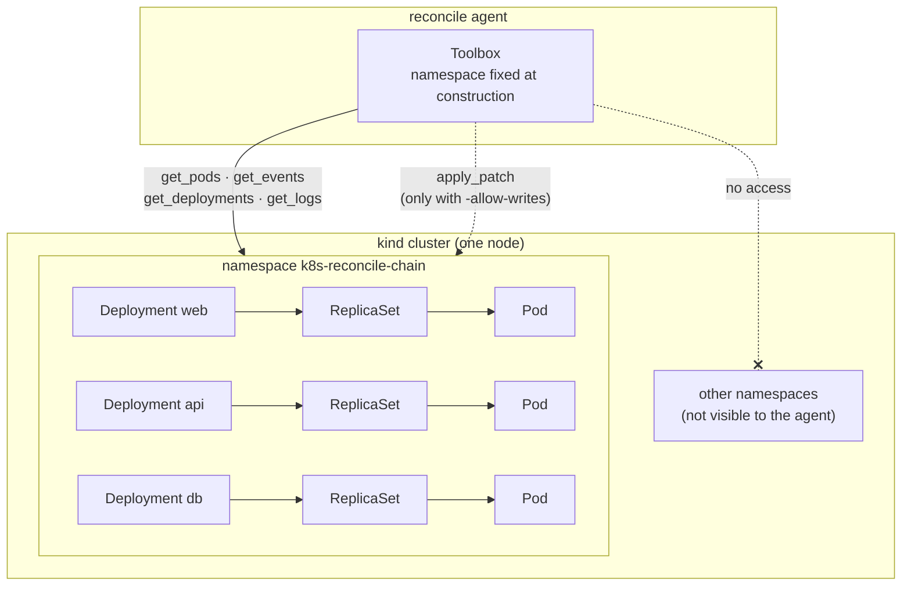
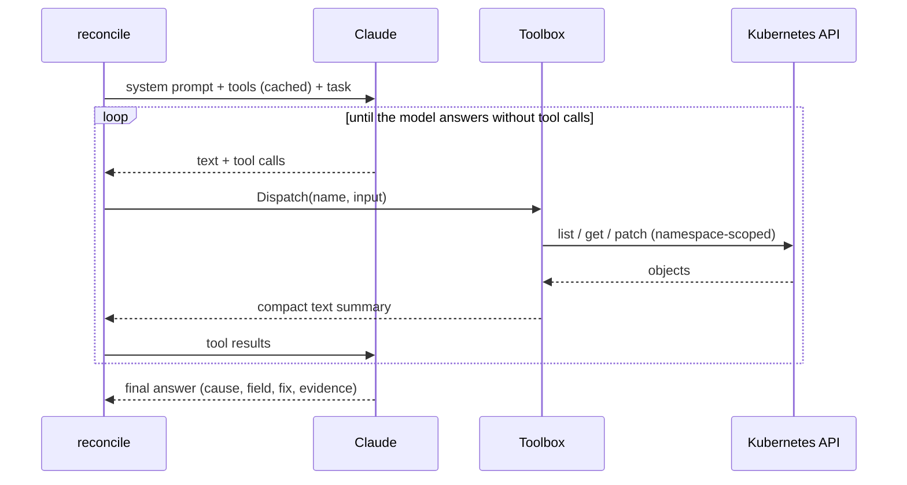
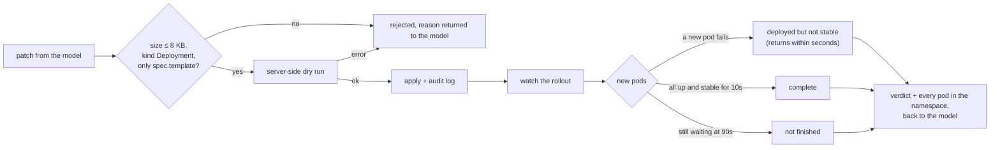
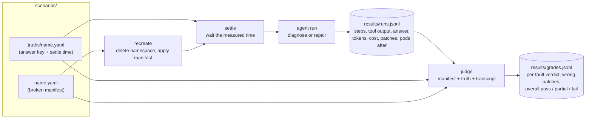

# K8s-Reconcile

An LLM agent that diagnoses and repairs broken Kubernetes workloads, and a benchmark that measures how well different models do it, and at what cost.

The agent is handed one namespace with something wrong in it. It investigates through a small set of read-only tools, explains the root cause, and, when writes are enabled, patches the broken Deployment and checks that the rollout actually recovered. The benchmark recreates each fault from a manifest, runs the agent against it, records every step with its token usage and cost, and grades the result against an answer key using an LLM judge.

**Stack:** Go · client-go · kind · Claude API (Anthropic Go SDK)

## How it works

### Scope: one namespace

The agent works at the level of a single **namespace**. Every tool is bound to that namespace when the toolbox is built, so the model never chooses where a tool runs and cannot reach anything outside it. Inside the namespace it sees Deployments, their Pods, events and container logs. It cannot see Services, ConfigMaps or Secrets, and it has no shell or `kubectl`.



### The agent loop

The agent is a single loop around the Messages API. Each step sends the conversation so far, runs any tools the model asks for, and appends their output. The run ends when the model answers without asking for a tool, or when it hits its step limit.



The tools return compact text, not raw JSON, so a step costs hundreds of tokens rather than thousands:

| Tool | Returns |
|---|---|
| `get_pods` | One line per pod: phase (or `Terminating`), readiness, a bucketed restart count, and why any container is unhealthy |
| `get_events` | The newest 20 events, sorted stably, with repeats collapsed |
| `get_deployments` | Each Deployment's replica counts, conditions and container spec: image, command, env (names and sources, never Secret values), probes, resources, mounts |
| `get_logs` | The last 50 lines from a pod, optionally from the previous container instance |
| `apply_patch` | Repair mode only; see below |

Tool definitions and the system prompt are sent with a cache breakpoint, so every step after the first reads them at 5–10% of the input price.

### Repairs: guarded writes

`apply_patch` is the only write path, and it is off unless the run passes `-allow-writes`. A patch goes through these checks before and after it reaches the cluster:



The rollout check is what lets the agent correct itself. It only looks at pods from the Deployment's current template, so a fix that reveals a second fault, or a fix applied on the wrong side, comes back to the model as a failure it can read and act on.

**Safety rules, enforced in code:** the namespace lock, writes off by default, no shell, Secret values never returned (only key names), patches limited to `spec.template`, and every applied patch recorded in an audit log.

## The benchmark



**Answer keys.** Every scenario has a truth file listing each fault: the object and field, the correct fix, whether it is repairable without information the agent can't see, what counts as partial credit, and which tempting fixes are wrong. It also lists objects that look suspicious but are healthy, and the state every Deployment should end in after a repair.

**Reproducible inputs.** Two runs of the same scenario should give the model the same tool output. Restart counts are bucketed (`none / 1 / several / many`). `ErrImagePull` and `ImagePullBackOff`, which alternate forever, are reported as one state. Each scenario waits a settle time measured from its own pod timeline, so it starts in the middle of a stable window: 15s for most, 30–80s for crash loops.

**Grading.** `cmd/judge` gives one model the manifest, the truth file and the full transcript, and requires it to answer through a strict-schema tool: a verdict per fault (correct, partial, wrong or missed), how many wrong patches reached the cluster, whether a healthy object was touched, and whether a value was invented. On a calibration set of 24 runs it matched hand grades on 23. The rubric was then tightened on the one disagreement.

## Scenarios

Each scenario runs in its own namespace. The tiers rise with how much reasoning a fault takes, not with how much is broken.

| Scenario | Tier | Fault | What it tests |
|---|---|---|---|
| `bad-image` | 1 | Image tag doesn't exist | Reading a pull error from events |
| `crashloop` | 1 | Startup script exits because `DATABASE_URL` is unset | Not inventing a value it can't know: the correct outcome is a report, not a patch |
| `readiness-probe` | 2 | Readiness probe on port 8080; nginx listens on 80 | Comparing the spec against the symptom |
| `unschedulable` | 2 | 64Gi memory request on a small node | Reading scheduler events for a pod that never started |
| `liveness-probe` | 3 | Liveness probe on `/healthz`, which nginx returns 404 for | A restart loop that looks like a crash but is the kubelet killing a healthy app |
| `multi-fault` | 3 | Bad image tag hiding a missing env var, a wrong probe port, and a healthy decoy | Several faults at once, one only visible after another is fixed, and leaving the healthy Deployment alone |
| `slow-start` | 4 | App sleeps 15s before listening; the liveness probe kills it at 2s | The same "connection refused" as a wrong port, but the port is fine and the cause is timing |
| `env-typo` | 4 | Env var spelled `DATABSE_URL`, with the right value | Looks like `crashloop`'s unfixable fault, but this one is repairable |
| `noisy` | 4 | One bad probe path among 8 Deployments | Finding one fault in long output, and leaving red herrings (a one-time restart, `ERROR` lines in healthy logs) alone |
| `cache-port` | 4 | Redis runs with `--port 6380`; the client and Service use 6379 | The cause is in a healthy-looking Deployment, and the error message shows the *correct* port |
| `client-port` | 4 | The client is set to port 6380; Redis is correct on 6379 | The mirror of `cache-port`: here the fix is on the client |
| `chain` | 4 | `db` binds to 127.0.0.1, so `api` can't reach it and `web` can't reach `api` | Following a symptom back two hops; removing a probe would turn every pod green while `db` is still broken |
| `wrong-host` | 4 | The client points at `postgres`; the database Deployment is `db` | Taking the right value from another object instead of inventing one |

## Results so far

90 runs: 13 scenarios, Claude Haiku 5.5 and Opus 5.5, diagnose and repair, 1–3 runs per combination.

| | Runs | Avg steps | Avg time | Cost per run | Caching saves |
|---|---|---|---|---|---|
| Haiku, diagnose | 27 | 3.0 | 6s | $0.0008 | 31% |
| Haiku, repair | 27 | 4.9 | 33s | $0.0020 | 30% |
| Opus, diagnose | 18 | 3.0 | 8s | $0.0232 | 40% |
| Opus, repair | 18 | 4.1 | 25s | $0.0440 | 41% |

Graded by the judge (Opus 5.5) against the answer keys:

| | Pass | Partial | Fail |
|---|---|---|---|
| Haiku, diagnose | 21 | 5 | 1 |
| Haiku, repair | 25 | 2 | 0 |
| Opus, diagnose | 18 | 0 | 0 |
| Opus, repair | 18 | 0 | 0 |

- Both models reached the expected end state in every repair run. Haiku did it at about 1/22 of Opus's cost per repair.
- Haiku's two partial repairs were both on `cache-port`, where the error message points at a value that is correct. It patched the client first, saw the rollout fail, and reverted. Opus fixed the server first in 3 of 3.
- Haiku's diagnoses lost credit for offering a wrong fix as an alternative (`cache-port`, `slow-start`), declining to commit to the right value (`wrong-host`), and once blaming the wrong Deployment (`cache-port`).
- Caching the tool definitions and system prompt cut cost by 30–41% per run. The rest of the input is conversation history, which is not cached yet.
- Grading all 90 runs cost $2.11. Graded twice, the judge gave the same verdict on every calibration run the rubric change didn't target.

The sample is small (1–3 runs per scenario per model), so these are signals, not rates.

## Running it

Requires Docker, kind, Go and an Anthropic API key.

```bash
kind create cluster --name reconcile
export ANTHROPIC_API_KEY=...
```

Check a namespace as it is now:

```bash
go run ./cmd/reconcile -namespace my-namespace -model haiku -verbose
```

Benchmark one scenario: recreate it, wait for it to settle, run the agent, and append the run to `results/runs.jsonl`:

```bash
go run ./cmd/reconcile -scenario cache-port -model opus -allow-writes
```

See what the tools return without calling the API:

```bash
go run ./cmd/reconcile -scenario chain -dump
```

Grade every ungraded run in `results/runs.jsonl`:

```bash
go run ./cmd/judge
```

Useful flags: `-model opus|sonnet|haiku`, `-allow-writes` for repair mode, `-verbose` to print each step, and on the judge, `-only scenario,...` to limit what it grades and `-show` to print a judge input without calling the API.

## Layout

```
cmd/reconcile     the agent: live checks and benchmark runs
cmd/judge         LLM judge over results/runs.jsonl
internal/agent    the loop and the diagnose / repair prompts
internal/llm      Messages API client, prompt caching, model aliases
internal/tools    namespace-scoped tools, patch guard, rollout check
internal/telemetry  token prices and cost per run
scenarios/        broken manifests, and truths/ with their answer keys
results/          runs.jsonl (every run) and grades.jsonl (the judge's grades);
                  logs/ holds console output, archive/ older runs and grades
```

## Next

- Escalation: start with Haiku and hand off to Opus when a Haiku patch fails its rollout check
- Ablations: thinking off, effort levels, caching the conversation history, trimmed tool output
- More scenarios where the symptom's own evidence looks correct, and more repeats on the ones that separate models
